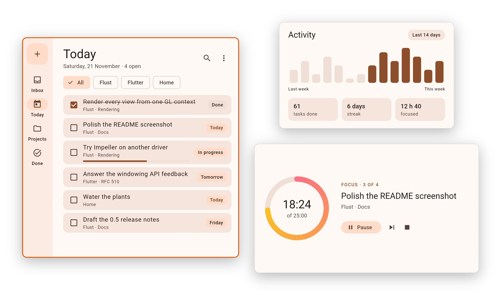

<h1 align="center">Flust</h1>

<p align="center">A Flutter embedder for Linux and Wayland, written in Rust.</p>

<p align="center">
  <a href="#quickstart">Quickstart</a> ·
  <a href="examples">Examples</a> ·
  <a href="packages/flust_flutter_tools/README.md"><code>flutter</code> tool extension</a> ·
  <a href="CONTRIBUTING.md">Contributing</a> ·
  <a href="https://github.com/vially/flust/issues">Issues</a>
</p>

<p align="center">
  <picture>
    <source media="(prefers-color-scheme: dark)" srcset="assets/readme/screenshot-dark.webp">
    
  </picture>
</p>

Flust runs [Flutter] apps in native Wayland windows, and lets you write the
native side of an app in Rust instead of C++.

It works with Flutter's own tools: `flutter run -d flust` with hot reload,
hot restart and DevTools, and `flutter build flust` for self-contained debug,
profile and release bundles.

## Status

Flust is **experimental**. Expect breaking changes, and don't use it for
anything that matters yet.

- **Wayland only.** There is no X11 support. The end-to-end tests run on
  sway. Other compositors, such as Mutter and KWin, haven't been tested
  much yet.
- **It needs a fork of Flutter.** `flutter run -d flust` works through
  Flutter's tool extensions, an experiment on Flutter's master channel
  whose remaining parts are still open pull requests. Until they land,
  Flust runs on [a fork of Flutter](packages/flust_flutter_tools/README.md#setup)
  that carries them.
- **Impeller is only tried on Mesa's `radeonsi` driver so far**, and there
  is no fallback to Skia if it fails to start. See
  [`flust-sctk`](flust-sctk/README.md#limitations) for the other known
  limitations.

## Features

- Native Wayland windows through [Smithay's client toolkit], with
  fractional scaling and smooth interactive resizing.
- The Impeller renderer by default, or Skia.
- Several windows per app: regular windows, dialogs, popups and tooltips,
  opened from Dart with Flutter's (still experimental) windowing API
  through the [`flust_windowing`](packages/flust_windowing) package.
- Accessibility: screen readers such as Orca read and drive the app
  through Flutter's semantics.
- Text input, keyboard and mouse cursors, localization, platform settings
  and app lifecycle.

## Requirements

- Linux with a Wayland compositor.
- A Rust toolchain. The examples use the 2024 edition, so Rust 1.85 or
  newer.
- OpenGL (ES) drivers. Impeller wants OpenGL ES 3.
- Flutter, from the fork with tool extensions. See
  [Setup](packages/flust_flutter_tools/README.md#setup), which also covers
  building the profile and release engines.

## Quickstart

After [setting up the Flutter fork](packages/flust_flutter_tools/README.md#setup),
run the `hello` example:

```sh
git clone https://github.com/vially/flust.git
cd flust/examples/hello
flutter pub get
flutter run -d flust
```

Add `--profile` or `--release` to run it in those modes. `flutter build
flust` builds the same app into `build/flust/<mode>/bundle` without running
it.

## Using Flust in your app

A Flust app is an ordinary Flutter app with a Rust runner next to it. Add
the tool extension to the app's `pubspec.yaml`:

```yaml
dev_dependencies:
  flust_flutter_tools:
    path: <flust checkout>/packages/flust_flutter_tools
```

Add Flust to the runner's `Cargo.toml`:

```toml
[dependencies]
flust = { path = "<flust checkout>/flust" }
```

The runner builds an `Application` and runs it:

```rust
use std::process::ExitCode;

use flust::{Backend, BackendConfigSctk, FlutterOpenGLTargetType, application::Application};

fn main() -> Result<ExitCode, Box<dyn std::error::Error>> {
    let config = BackendConfigSctk::from(FlutterOpenGLTargetType::Framebuffer);

    // The Flutter bundle is loaded from `data/` and `lib/`, next to the binary.
    let app = Application::builder()
        .with_backend(Backend::Sctk(config))
        .with_title("Hello Flust")
        .with_app_id("com.example.hello")
        .build()?;

    Ok(app.run()?)
}
```

[`examples/`](examples) has complete apps laid out this way, and
[`flust_flutter_tools`](packages/flust_flutter_tools/README.md#using-it-in-an-app)
explains where the runner goes in a Flutter project.

## Documentation

| Where | What it covers |
| --- | --- |
| [`examples/`](examples) | Example apps, and how to build and run them |
| [`packages/flust_flutter_tools`](packages/flust_flutter_tools/README.md) | `flutter run -d flust`, `flutter build flust`, and setting up the Flutter fork |
| [`flust-sctk`](flust-sctk/README.md) | The Wayland backend: rendering, Impeller and Skia, limitations |
| [`flust-accessibility`](flust-accessibility/README.md) | Screen reader support and what works |
| [`tests/e2e`](tests/e2e/README.md) | The end-to-end tests |
| [`CONTRIBUTING.md`](CONTRIBUTING.md) | How the workspace is laid out |

## Contributing

Bug reports and pull requests are welcome on [GitHub][issues]. See
[CONTRIBUTING.md](CONTRIBUTING.md) for how the code is organized, and
[`tests/e2e`](tests/e2e/README.md) for running the end-to-end tests before
sending a change that affects what's on screen.

## License

Flust is licensed under the [MIT license](LICENSE).

## Acknowledgements

[`flutter-rs`](https://github.com/flutter-rs/flutter-rs) - For providing
the solid foundation that Flust was originally forked from and builds on
top of. The Flust project would not be possible without the awesome work
of the `flutter-rs` contributors.

Flust started as a couple of changes on top of the `flutter-rs` project,
with the intention of merging them back into upstream. However, by the time
the patches turned into something that might be usable upstream, the
`flutter-rs` project was [no longer maintained](https://github.com/flutter-rs/flutter-rs/issues/156#issuecomment-859392523)
so a decision was made to fork the project and rename it to Flust.

[Flutter]: https://flutter.dev
[Smithay's client toolkit]: https://github.com/Smithay/client-toolkit
[issues]: https://github.com/vially/flust/issues
