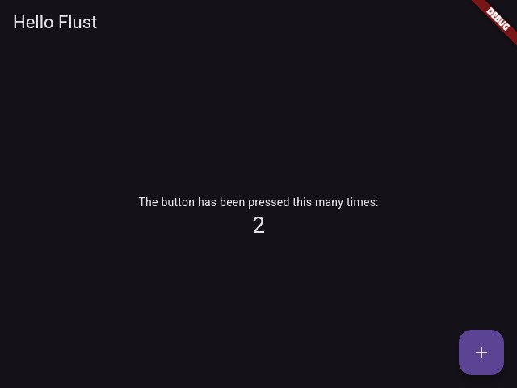

# hello

The smallest Flust app: one window with a counter in it.

The runner, [`src/main.rs`](src/main.rs), builds an `Application` on the
`flust-sctk` backend, gives its window a title and an app id, and runs it.
Everything else comes from defaults: the Flutter bundle is loaded from
`data/` next to the binary, and the window opens at its default size.

The Dart side, [`lib/main.dart`](lib/main.dart), is an ordinary Flutter app.
Nothing in it is specific to Flust.

See [the examples' README](../README.md) for how to build and run it.
